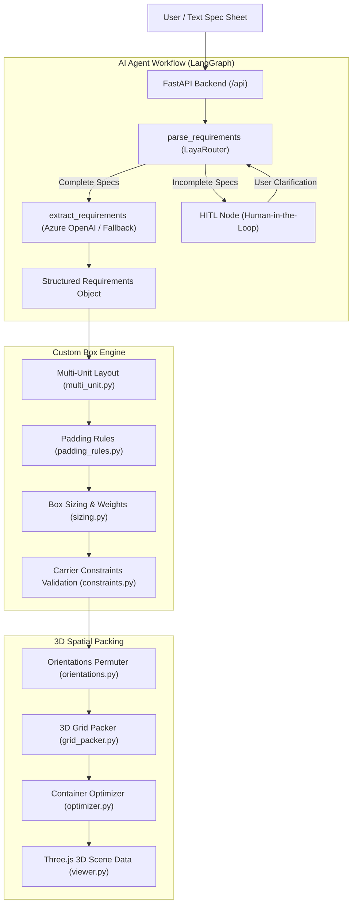

# 3D Packing Optimizer — Project Documentation & Changelog

## 1. Executive Summary

The **3D Packing Optimizer** is an end-to-end intelligent engineering and logistics application designed to automate the lifecycle of industrial packaging:
1. **AI Requirement Extraction**: Accepts unstructured textual specifications or spec sheets and extracts structured part dimensions, weight, material type, and Standard Pack Quantity (SNP).
2. **Custom Box Sizing & Multi-Unit Layout**: Calculates custom box sizing, foam padding clearance based on part fragility, 3D multi-unit arrangement grids ($n_x \times n_y \times n_z = \text{SNP}$), tare weights, and carrier shipping constraints.
3. **3D Spatial Packing Optimization**: Fits multiple parts into standard or custom containers using a 3D corner-point placement heuristic with 6-degree orthogonal rotations, generating scene coordinates ready for WebGL / Three.js 3D rendering.
4. **Standard Industrial Dataset**: Provides a 50-part benchmark dataset featuring realistic manufacturing parts with wide size and weight variety, specifically shaped as simple 3D geometric primitives.

---

## 2. Architecture & Workflow



---

## 3. Project Directory Structure

```
packing-optimizer-3d/
├── PROJECT_DOCUMENTATION.md          # Comprehensive project history and technical documentation
├── README.md                         # Quickstart guide
├── backend/
│   ├── requirements.txt              # Python dependencies specification
│   ├── products_dataset.csv          # 50-item benchmark dataset for packing optimization
│   ├── data/
│   │   ├── materials.json            # Packaging box materials (corrugated, plastic, wood)
│   │   ├── padding_rules.json        # Fragility and cushion thickness rules by material
│   │   └── products_dataset.csv      # Data copy for backend services
│   └── app/
│       ├── main.py                   # FastAPI server entry point with CORS and routes
│       ├── models.py                 # AzureChatOpenAI client configuration
│       ├── validation.py             # Physical dimension & weight validation logic
│       ├── agents/
│       │   ├── __init__.py           # Agent exports
│       │   └── requirement.py        # LangGraph workflow, LayaRouter, & HITL logic
│       ├── api/
│       │   ├── __init__.py           # Route collection exports
│       │   ├── requirement_routes.py # AI agent endpoints (/api/requirements)
│       │   ├── custom_box_routes.py  # Sizing & product endpoints (/api/custom-box)
│       │   └── packing_routes.py     # 3D bin packing endpoints (/api/packing)
│       ├── custom_box/
│       │   ├── __init__.py
│       │   ├── constraints.py        # Parcel carrier & material strength checks
│       │   ├── multi_unit.py         # 3D grid layout optimization for SNP > 1
│       │   ├── padding_rules.py      # Foam & clearance determination
│       │   └── sizing.py             # Internal/external dimensions, tare, & gross weights
│       ├── packing/
│       │   ├── __init__.py
│       │   ├── grid_packer.py        # 3D corner-point container placement heuristic
│       │   ├── optimizer.py          # Multi-carton candidate evaluation
│       │   └── orientations.py       # 6-degree orthogonal rotation permutations
│       └── render/
│           ├── __init__.py
│           └── viewer.py             # Three.js 3D scene dictionary generator
└── frontend/                         # Vite + React + TypeScript frontend
```

---

## 4. Chronological Project Progress & Implementation Details

### Phase 1: Repository Discovery & Skeleton Assessment
- Inspected the repository tree and git history.
- Discovered that the repository contained empty placeholder files created during initial skeleton setup (`custom_box_routes.py`, `packing_routes.py`, `sizing.py`, `optimizer.py`, etc., were 0 bytes).

### Phase 2: Requirement Agent (`backend/app/agents/requirement.py`)
- **Resolved LangGraph Import Bugs**: Corrected top-level imports to import `START`, `END`, and `StateGraph` from `langgraph.graph`.
- **Integrated LayaRouter**: Fixed parameter naming (`confidence_threshold = 0.8`), criteria routing, and added a safe heuristic fallback if local HuggingFace weights or network access are unavailable.
- **Implemented Human-in-the-Loop (HITL)**: Added the `HITL` node to handle missing or ambiguous specifications.
- **Configured StateGraph Topology**:
  - `START` $\rightarrow$ `parse_requirements`
  - Conditional edge: `route_requirements` $\rightarrow$ `extract_requirements` (if complete) or `HITL` (if incomplete)
  - Both branches terminate at `END`.
  - Compiled the runnable graph to `app = requirementagent.compile()`.
- **Schema & Resilience**:
  - Aliased `parth_height` to `part_height` via Pydantic `AliasChoices` and a property getter.
  - Made dimension fields `float` to support decimal measurements.
  - Added an offline regex fallback extractor so that unit tests and offline environments work even before Azure OpenAI credentials are configured.
- **LLM Configuration (`backend/app/models.py`)**:
  - Fixed missing `import os`.
  - Updated legacy `AzureOpenAI` to `AzureChatOpenAI` so that `.with_structured_output(Requirements)` is supported natively.

### Phase 3: Domain Engineering & Physical Packaging Engine
- **Materials Database (`backend/data/materials.json`)**: Configured ECT 32 single-wall cardboard, ECT 48 double-wall heavy duty, ECT 71 triple-wall industrial, fluted polypropylene plastic, and wooden crating with densities, burst strengths, and costs per square meter.
- **Padding Rules (`backend/data/padding_rules.json`)**: Formulated cushion recommendations (EPE foam, ESD anti-static foam, bubble wrap, EVA foam) and clearance thickness ($10\text{ mm} - 35\text{ mm}$) keyed to material fragility.
- **Box Sizing Engine (`backend/app/custom_box/sizing.py`)**:
  - Calculates internal dimensions ($L_{\text{in}} = L + 2 \times \text{padding}$).
  - Calculates external dimensions ($L_{\text{ex}} = L_{\text{in}} + 2 \times \text{wall}$).
  - Computes surface area, material tare weight, padding volume weight, gross weight, and IATA volumetric weight ($L \times W \times H / 5000$).
- **Multi-Unit Layout Engine (`backend/app/custom_box/multi_unit.py`)**:
  - Given an SNP (e.g. 12 units), finds all 3D factor triplets ($n_x \times n_y \times n_z = 12$).
  - Incorporates internal dividers and scores layouts to minimize surface area and aspect-ratio distortion.
- **Constraints Validator (`backend/app/custom_box/constraints.py`)**:
  - Enforces carrier parcel thresholds (FedEx / UPS limits: length $\le 2740\text{ mm}$, length $+$ girth $\le 4000\text{ mm}$, weight $\le 70\text{ kg}$).
  - Flags high aspect ratios ($> 5:1$) prone to crushing.

### Phase 4: 3D Spatial Packing Optimizer
- **Orientations Engine (`backend/app/packing/orientations.py`)**:
  - Generates up to 6 orthogonal 3D permutations: $(L, W, H)$, $(L, H, W)$, $(W, L, H)$, $(W, H, L)$, $(H, L, W)$, $(H, W, L)$.
  - Supports `allow_rotation=False` and `keep_upright=True` (yaw-only rotation).
- **3D Grid Packer (`backend/app/packing/grid_packer.py`)**:
  - Uses a corner-point candidate heuristic placing items bottom-to-top, back-to-front, left-to-right.
  - Checks for exact 3D bounding box overlaps and container boundaries.
  - Computes volumetric utilization percentage and lists unplaced items with clash reasons.
- **Multi-Carton Optimizer (`backend/app/packing/optimizer.py`)**:
  - Evaluates standard cartons (Small, Medium, Large, Extra Large, Industrial) to select the container with maximum volume utilization.
- **3D Viewer Scene Bridge (`backend/app/render/viewer.py`)**:
  - Generates centroid coordinates, dimensions, bounding boxes, and distinct hex colors for Three.js rendering.

### Phase 5: REST API Services & FastAPI Integration
- **`backend/app/main.py`**:
  - Configured FastAPI with CORS middleware (`*` / `localhost:5173`).
  - Mounted `/api/requirements`, `/api/custom-box`, and `/api/packing`.
  - Added health checks (`GET /` and `GET /health`).
- **Synchronous Handler Optimization**:
  - Declared CPU-bound algorithmic handlers as standard `def` functions so FastAPI manages them on worker threadpools without event loop contention.

### Phase 6: Product Benchmark Dataset (`products_dataset.csv`)
- **Dataset Creation**:
  - Created [`backend/products_dataset.csv`](file:///c:/Users/ManuSebastian/Downloads/packing-optimizer-3d/backend/products_dataset.csv) and mirrored to [`backend/data/products_dataset.csv`](file:///c:/Users/ManuSebastian/Downloads/packing-optimizer-3d/backend/data/products_dataset.csv).
  - Includes **50 realistic components** designed as simple 3D geometric primitives (boxes, cylinders, plates, L/U-extrusions) for easy CAD / Three.js modeling.
  - **Dynamic Range**:
    - Length: $25\text{ mm}$ to $1150\text{ mm}$ ($\sim 46\times$ range)
    - Height: $4\text{ mm}$ to $540\text{ mm}$ ($\sim 135\times$ range)
    - Weight: $0.02\text{ kg}$ ($20\text{g}$) to $42.0\text{ kg}$ ($\sim 2100\times$ range)
  - Fields: `part_name`, `part_length`, `part_breadth`, `part_height`, `part_weight`, `part_type`, `standard_no_of_parts`, `domestic_or_international`, `per_day_requirement`, `minimum_order_quantity`, `line_feeding_method`.
- Added `GET /api/custom-box/products` endpoint to query and filter the dataset directly.

### Phase 7: Clean Dependency Specification (`requirements.txt`)
- Replaced the previous binary-encoded requirements file with a clean, UTF-8 encoded [`backend/requirements.txt`](file:///c:/Users/ManuSebastian/Downloads/packing-optimizer-3d/backend/requirements.txt) covering FastAPI, LangGraph, LangChain, OpenAI, Laya, and NumPy.

---

## 5. API Reference

| Endpoint | Method | Input Payload | Output / Description |
|---|---|---|---|
| `/` | `GET` | None | API status and endpoint directory |
| `/health` | `GET` | None | `{"status": "healthy"}` |
| `/api/requirements/analyze` | `POST` | `{"requirement": "text"}` | Runs LangGraph agent; returns `fullfilled`, `requirements`, or `hitl_reason` |
| `/api/requirements/parse` | `POST` | `{"requirement": "text"}` | Quick LayaRouter completeness check (`extract_requirements` vs `HITL`) |
| `/api/requirements/extract` | `POST` | `{"requirement": "text"}` | Directly extracts structured `Requirements` schema |
| `/api/requirements/hitl/resolve` | `POST` | `{"original_requirement": "...", "additional_info": "..."}` | Appends user clarifications and re-runs the agent |
| `/api/custom-box/products` | `GET` | None | Returns the 50 products from `products_dataset.csv` |
| `/api/custom-box/materials` | `GET` | None | Returns list of supported box materials |
| `/api/custom-box/padding-rules` | `GET` | None | Returns padding thickness and cushion rules |
| `/api/custom-box/calculate` | `POST` | `CustomBoxCalculationRequest` | Returns multi-unit layout, padding, box sizing, weights, and constraints |
| `/api/packing/cartons` | `GET` | None | Lists predefined standard carton dimensions |
| `/api/packing/pack` | `POST` | `PackRequest` (container + items) | Returns placed coordinates and Three.js scene data |
| `/api/packing/optimize` | `POST` | `OptimizeRequest` (items) | Evaluates multiple cartons and selects the highest-utilization box |

---

## 6. How to Run & Verify

### 1. Activate Environment & Run Server
```powershell
cd backend
.\.venv\Scripts\Activate.ps1
uvicorn app.main:app --host 0.0.0.0 --port 8000 --reload
```

### 2. Interactive Swagger UI
Open your browser to:
[http://localhost:8000/docs](http://localhost:8000/docs)

### 3. Verify Product Dataset via API
```powershell
curl http://localhost:8000/api/custom-box/products
```

