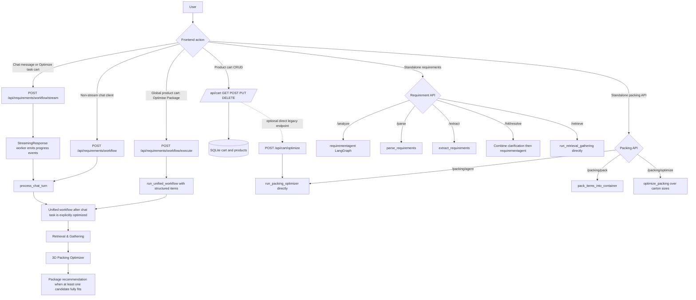
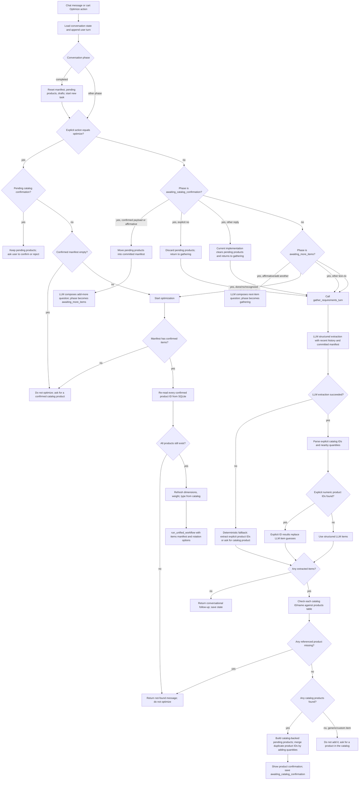
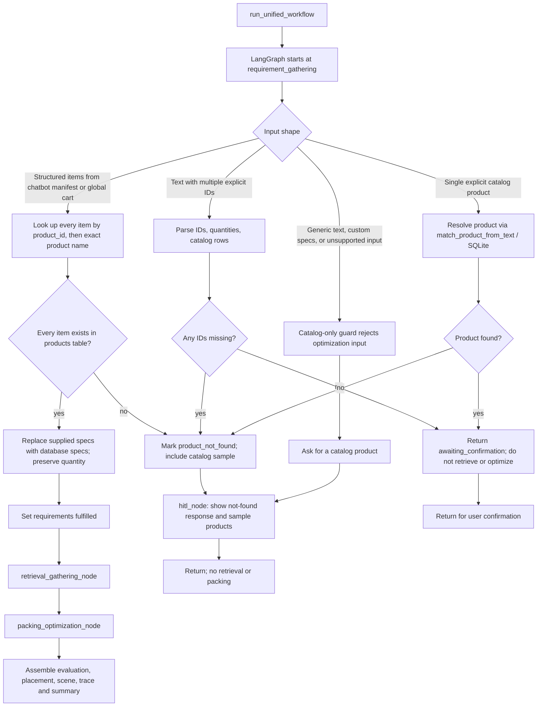

# AI System: Complete Decision Flow

This document maps the backend routes and decision paths as implemented. The chatbot conversation, structured cart optimization, direct utility APIs, and legacy requirement APIs are separate entry points; they converge on the unified workflow only where indicated.

## 1. Entry points

The **chatbot task cart** is the confirmed manifest stored with the conversation. The **global product cart** is the SQLite-backed cart opened from the app header. The former optimizes through the conversational workflow; the latter uses `/workflow/execute` when its UI button is clicked.

## 2. Chatbot requirement gathering and task state

### What is extracted and persisted

- `gather_requirements_turn` calls the structured-output LLM on gathering turns. If it fails, `_fallback_requirement_turn` only deterministically extracts explicit catalog IDs; it does not gather custom dimensions for optimization.
- `_explicit_catalog_items` parses per-ID quantities (including the supported common misspellings of “product”) and looks up product names in SQLite. For a prompt such as `20 of product 1 and 20 of product 30`, each record gets its own quantity of 20.
- `pending_products` are awaiting confirmation. Only after confirmation are catalog rows appended to `manifest`. The conversation state (`phase`, `history`, `manifest`, `pending_products`) is persisted by `conversation_store.py`.
- The chatbot’s Optimize button sends an explicit `action: "optimize"`; it does not depend on the natural-language done-intent regex or on being in `awaiting_more_items`. It still refuses to run while a catalog confirmation is pending.

## 3. Unified workflow: catalog gate and agent routing

In the chatbot confirmation flow, product confirmation happens in `conversation_workflow.py`; after the user presses Optimize, the structured `items` branch validates the manifest again in `requirement_gathering_node`. Structured global-cart items follow the same database-backed branch. Direct textual product requests in the unified workflow can stop at a separate confirmation response before retrieval.

## 4. Retrieval, 3D placement, and package recommendation

```mermaid
flowchart TD
    RET[retrieval_gathering_node] --> CALC[run_retrieval_gathering]
    CALC --> METRICS[calculate_metrics: resolve catalog rows and compute item metrics]
    METRICS --> MULTI{Multiple product records?}
    MULTI -->|yes| EACH[Resolve each row; preserve each quantity; compute aggregate volume and weight]
    MULTI -->|no| SINGLE[Resolve one row; compute quantity, payload, layout and padding]
    EACH --> BBOX[Compute padded effective dimensions and total payload]
    SINGLE --> BBOX
    BBOX --> DB[fetch_all_candidates_from_db: packages, metal_stillages, metal_pallets, base_pallets]
    DB --> CSV{Carton rows available?}
    CSV -->|no| CSVLOAD[Load packages.csv as carton fallback]
    CSV -->|yes| FILTER
    CSVLOAD --> FILTER[Filter out known zero inventory; check rotated 3D bounds and verified payload rating]
    FILTER --> FITS{Any rated candidates fit metrics?}
    FITS -->|cartons fit| RANKC[Rank cartons by product-volume utilization; select top max_results; optionally add top heavy-duty option]
    FITS -->|only heavy-duty fits| RANKH[Rank fitting stillages/pallets]
    FITS -->|none fit| EMPTY[Return no matching packages and narrowing explanation]
    RANKC --> CAND[Return narrowed candidates, all-fit count, queried tables and metrics]
    RANKH --> CAND
    EMPTY --> CAND

    CAND --> NODE3[packing_optimization_node maps candidate packages to container inputs]
    NODE3 --> EP[run_packing_optimizer]
    EP --> PREP[prepare_items_and_containers: flatten each quantity into individual units]
    PREP --> CAND2{Explicit candidate_containers non-empty?}
    CAND2 -->|yes| TEST[Evaluate each candidate container]
    CAND2 -->|no| AUTORET[Optimizer attempts retrieval again from representative item; if unavailable uses built-in carton defaults]
    AUTORET --> TEST
    TEST --> PLACE[extreme_point_packing: try orientations and extreme-point coordinates; reject boundary/clash placements]
    PLACE --> CAP[Check placed count and package payload limit]
    CAP --> RANK{Any container fits every unit and weight?}
    RANK -->|yes| BEST[Choose full-fit container with highest utilization]
    RANK -->|no| PARTIAL[Choose partial result by most items placed, then utilization]
    BEST --> FEASIBLE[Build feasible recommendation candidate set]
    FEASIBLE --> MODEL{Recommendation model configured?}
    MODEL -->|yes| LLMREC[LLM selects one ID from feasible candidates]
    LLMREC --> VALIDREC{Returned ID is in feasible set?}
    VALIDREC -->|yes| OUTPUT[Build final package recommendation and 3D scene]
    VALIDREC -->|no| ERROR[Raise recommendation error]
    MODEL -->|no| DETER[Deterministic recommendation by utilization, inventory tie-break, then wasted volume]
    DETER --> OUTPUT
    LLMREC -. model invocation fails .-> DETER
    PARTIAL --> OUTPUT2[Return partial-fit result; no package recommendation]
```

`calculate_metrics` runs before the 3D solver. For a multi-product task it keeps per-product records for packing, while computing aggregate payload and volume metrics for package filtering. `run_packing_optimizer` then expands quantities into discrete unit boxes and tests them against each container. Recommendation is only run on containers that passed the deterministic full-fit and weight checks.

## 5. Separate requirement and packing APIs

These endpoints are available independently and do not all invoke the full three-agent workflow:

| Endpoint | Backend path | Decision behavior |
|---|---|---|
| `POST /api/requirements/analyze` | `requirement_app.invoke` | Laya/deterministic completeness gate → extraction or HITL response |
| `POST /api/requirements/parse` | `parse_requirements` | Returns `extract_requirements` or `HITL`; does not optimize |
| `POST /api/requirements/extract` | `extract_requirements` | Catalog lookup first; then structured LLM; deterministic extraction fallback if LLM fails |
| `POST /api/requirements/hitl/resolve` | Combine original text and clarification → `requirement_app.invoke` | Re-runs completeness and extraction; does not continue the unified packing graph |
| `POST /api/requirements/retrieve` | `run_retrieval_gathering` | Computes metrics and queries packages; no 3D unit placement |
| `POST /api/packing/pack` | `pack_items_into_container` | Grid-packs into the one supplied container |
| `POST /api/packing/optimize` | `optimize_packing` | Evaluates standard or supplied containers using the service optimizer |
| `POST /api/packing/agent` | `run_packing_optimizer` | Runs the Extreme Point agent directly |
| `POST /api/cart/optimize` | `run_packing_optimizer` | Legacy cart route; direct packing path, not the full unified retrieval/recommendation graph |

## 6. Source map

- Chat route and structured cart route: `backend/app/api/requirement_routes.py`
- Conversation state machine and database-backed manifest: `backend/app/agents/conversation_workflow.py`
- Conversational LLM extraction and explicit ID parser: `backend/app/agents/requirement.py`
- Unified requirement gate, LangGraph routing, result assembly: `backend/app/agents/workflow.py`
- Metrics, database candidate retrieval, and ranking: `backend/app/agents/retrieval_gathering.py`
- Unit expansion, candidate preparation, 3D Extreme Point placement, ranking: `backend/app/agents/packing_optimizer.py`
- Feasible-package recommendation: `backend/app/agents/package_recommendation.py`
- Conversation persistence: `backend/app/services/conversation_store.py`
- Independent endpoints: `backend/app/api/requirement_routes.py`, `backend/app/api/packing_routes.py`, and `backend/app/api/cart_routes.py`
